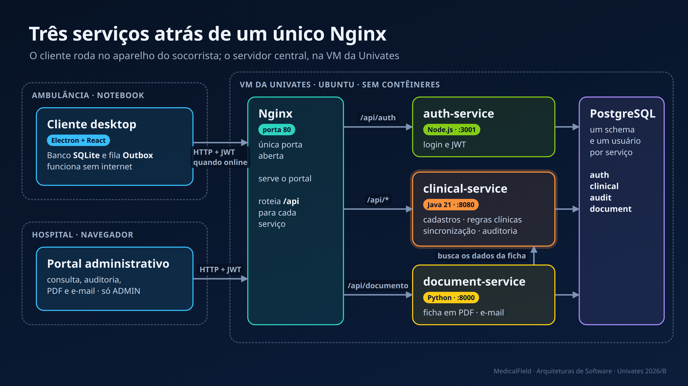
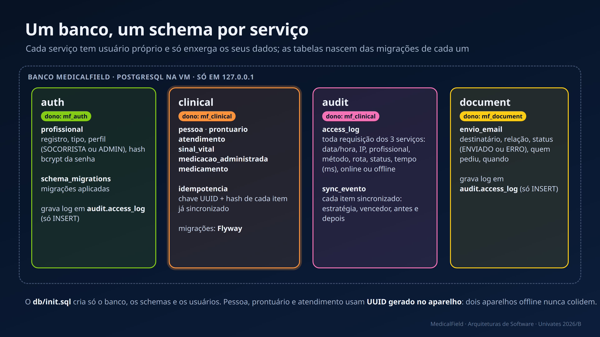
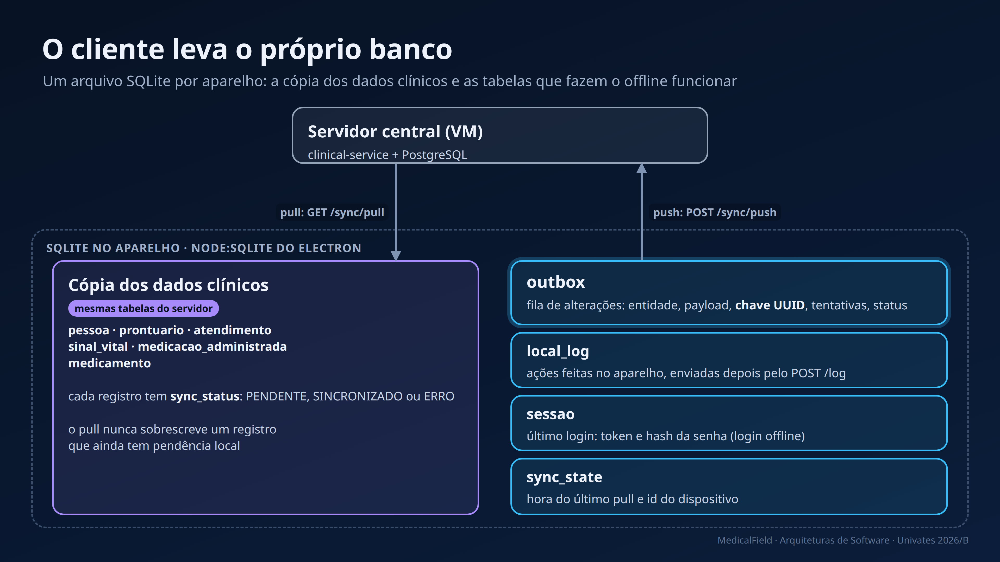
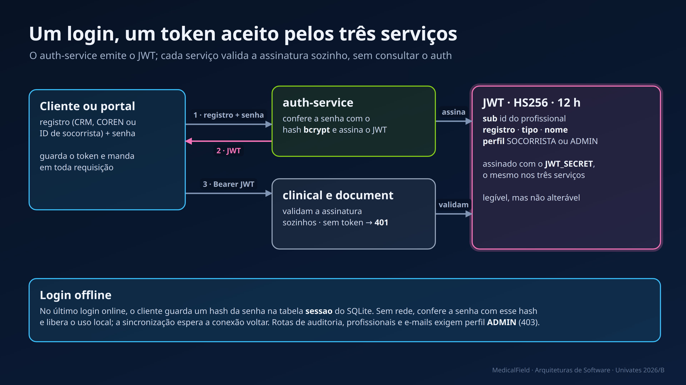
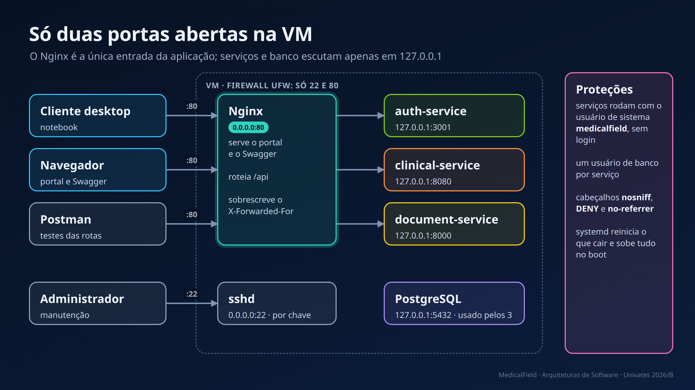
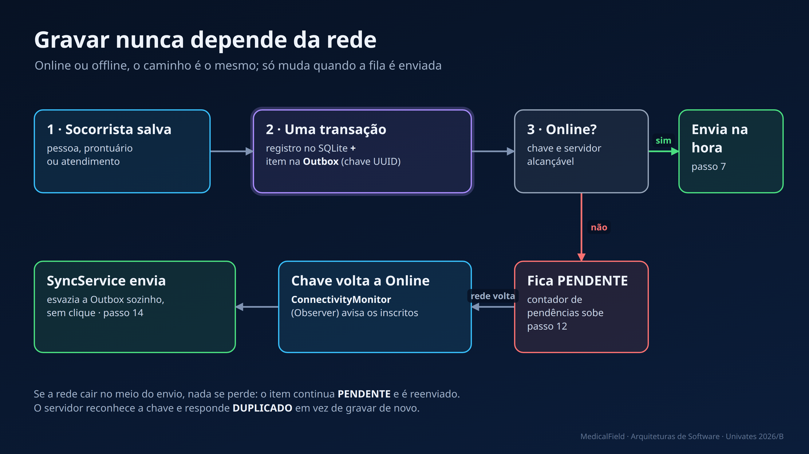
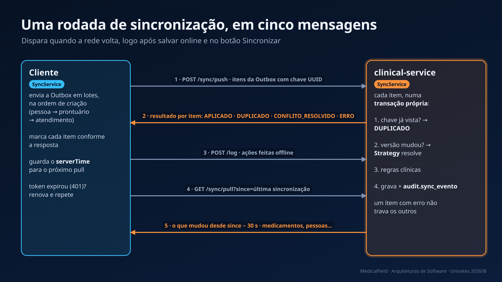
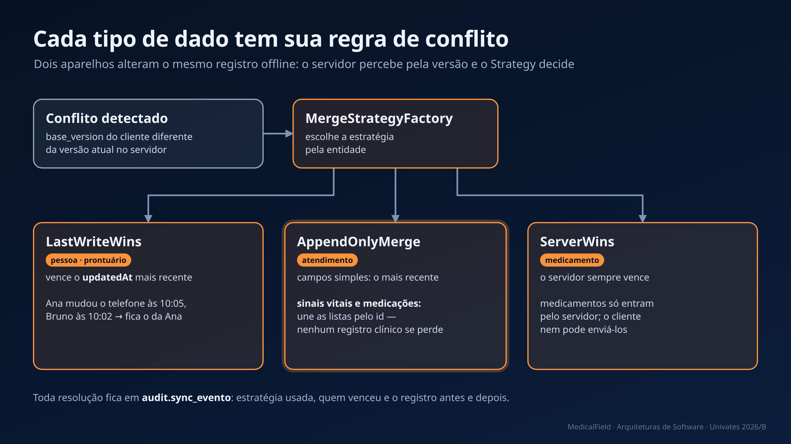
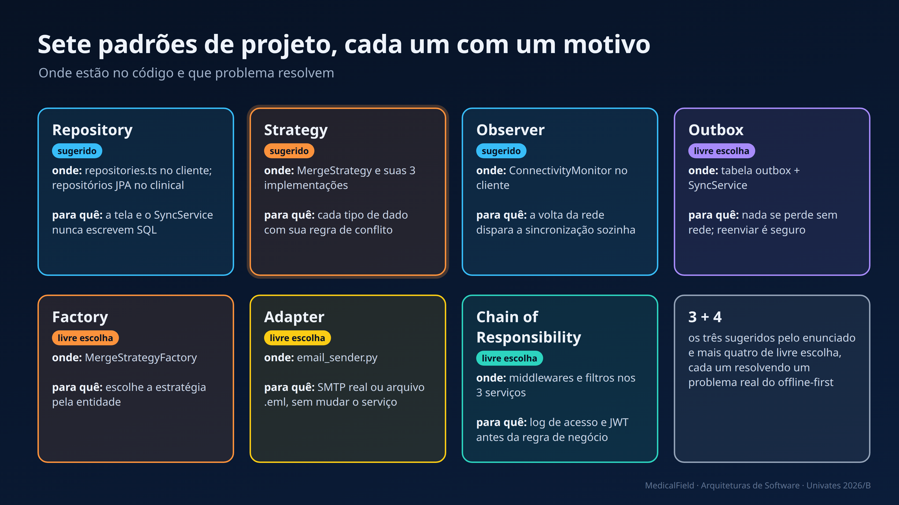

# MedicalField · Guia de demonstração

O documento para estudar antes de apresentar. A **Parte I** explica o sistema peça por peça, com o lugar de cada coisa no código. A **Parte II** percorre os 17 passos do roteiro contando o que acontece por trás de cada um. Para a hora em si, use a [cola rápida](ROTEIRO-DA-APRESENTACAO.md).

---

# Parte I · O sistema

## 1. A ideia: offline-first

Socorristas atendem onde a internet cai. O MedicalField inverte a lógica do "online com plano B": **toda gravação vai primeiro para um banco local**, entra numa **fila (Outbox)** e é enviada ao servidor quando a conexão volta.

Isso cria três problemas, e o resto do sistema existe para resolvê-los:

| Problema | Solução | Onde |
| --- | --- | --- |
| Um envio que cai no meio é reenviado e pode duplicar | **Idempotência**: cada item da fila tem uma chave UUID; o servidor reconhece o que já recebeu | `clinical.idempotencia` |
| Dois aparelhos alteram o mesmo registro offline | **Estratégias de conflito** (Strategy), uma por tipo de dado | `sync/` no clinical-service |
| Em saúde é preciso saber quem fez o quê, inclusive offline | **Auditoria** de toda requisição + logs locais enviados depois | `audit.access_log`, `local_log` |

> O cliente nunca espera a rede; o servidor nunca confia que um envio é o primeiro.

## 2. Arquitetura

| Peça | Onde roda | Tecnologia | Responsabilidade | Código |
| --- | --- | --- | --- | --- |
| Cliente desktop | Notebook do socorrista | Electron + React + SQLite | Registrar tudo, mesmo offline, e sincronizar | `client/` |
| Portal | Navegador (servido pela VM) | React + Vite | Consultar, gerar PDF, enviar e-mail · só ADMIN | `portal/` |
| Nginx | VM, porta 80 | Nginx | Porta de entrada única: serve o portal e roteia `/api` | `deploy/nginx/` |
| auth-service | VM, `127.0.0.1:3001` | Node.js + Express | Login e emissão do JWT | `services/auth-service/` |
| clinical-service | VM, `127.0.0.1:8080` | Java 21 + Spring Boot | Cadastros, regras clínicas, sincronização, auditoria | `services/clinical-service/` |
| document-service | VM, `127.0.0.1:8000` | Python + FastAPI | Ficha em PDF e envio por e-mail | `services/document-service/` |
| PostgreSQL | VM, `127.0.0.1:5432` | PostgreSQL | Banco central, um schema por serviço | `db/` |

**Por que três linguagens?** O enunciado exige, para refletir ambientes reais de saúde, mas cada escolha tem motivo: Node é leve para o login; Java/Spring é robusto para o núcleo transacional; Python tem a melhor biblioteca de PDF (ReportLab).

## 3. Bancos de dados

- **Um schema e um usuário por serviço.** Cada serviço só enxerga os próprios dados — o princípio "cada microsserviço é dono dos seus dados", sem precisar de três bancos.
- **As tabelas nascem das migrações** de cada serviço (Flyway no Java; um migrador simples no Node e no Python). O `db/init.sql` cria só o banco, os schemas e os usuários.
- O schema `audit` é do clinical-service, que por isso **sobe primeiro**; auth e document só têm permissão de inserir em `audit.access_log`.
- **IDs UUID gerados no aparelho**: dois aparelhos offline nunca criam o mesmo ID.
- **Cada registro tem `version`**, que sobe a cada alteração: é a base da detecção de conflito.

O cliente tem as mesmas tabelas clínicas e mais quatro de controle: `outbox` (fila), `local_log` (ações feitas no aparelho), `sessao` (último login, para o login offline) e `sync_state` (hora do último pull).

## 4. Login e segurança

1. O profissional entra com o registro (CRM, COREN ou ID de socorrista) e a senha.
2. O auth-service confere a senha com o hash **bcrypt** e assina um **JWT HS256** válido por 12 horas, com `sub`, `registro`, `tipo`, `nome` e `perfil`.
3. Os três serviços compartilham o `JWT_SECRET` e **validam o token sozinhos**: se o auth cair, quem já entrou continua trabalhando.
4. Sem token ou com token inválido: **401**. O login é a única rota pública.
5. `GET /profissional`, `GET /log` e `GET /documento/envio` exigem perfil **ADMIN** (403 para socorristas); o portal também só aceita administradores.

**Login offline:** no último login online, o cliente guarda um hash da senha na tabela `sessao`. Sem rede, confere a senha com esse hash e libera o uso local.

Na VM só as portas 22 (SSH, por chave) e 80 (Nginx) ficam abertas. Os serviços e o banco escutam em `127.0.0.1`; o Nginx sobrescreve o `X-Forwarded-For` (o IP gravado no log não pode ser forjado) e envia os cabeçalhos `nosniff`, `DENY` e `no-referrer`. O systemd reinicia o que cair e sobe tudo no boot.

## 5. Gravação offline e sincronização

Ao salvar, o cliente grava o registro e o item da Outbox **na mesma transação** do SQLite: ou os dois acontecem, ou nenhum. Online ou offline, o caminho é o mesmo; só muda quando a fila é enviada.

Uma rodada tem três etapas: **push** da Outbox (`POST /sync/push`), envio dos **logs locais** (`POST /log`) e **pull** das novidades (`GET /sync/pull?since=…`). Ela dispara quando a chave volta a Online (Observer), logo após salvar online e no botão **Sincronizar**.

No servidor, cada item é aplicado numa **transação própria**:

1. A chave já foi vista com o mesmo conteúdo → `DUPLICADO`, nada é gravado de novo.
2. A versão do servidor mudou desde que o cliente editou → a estratégia de conflito resolve (`CONFLITO_RESOLVIDO`).
3. As regras clínicas são aplicadas; se falharem, o item volta como `ERRO` sem travar os outros.
4. O registro é gravado e o evento vai para `audit.sync_evento`.

O pull devolve o que mudou desde `since − 30 s`: a margem cobre uma gravação que começou antes do pull anterior e só terminou depois. Receber de novo não faz mal — o cliente grava por upsert e não toca em registros com pendência local.

## 6. Conflitos

| Entidade | Estratégia | Como resolve |
| --- | --- | --- |
| Pessoa, prontuário | **LastWriteWins** | Vence o `updatedAt` mais recente |
| Atendimento | **AppendOnlyMerge** | Campos simples seguem o mais recente; sinais vitais e medicações são **unidos** pelo id — nenhum registro clínico se perde |
| Medicamento | **ServerWins** | O servidor sempre vence; o cliente nem pode enviar medicamento |

A `MergeStrategyFactory` escolhe a estratégia pela entidade. Toda resolução fica em `audit.sync_evento` com a estratégia, quem venceu e o registro antes e depois.

## 7. Regras clínicas

Aplicadas no cliente (para alertar offline, `client/src/main/rules.ts`) e de novo no servidor (`ClinicalRules.java`), porque qualquer um pode chamar a API direto:

- **Dose máxima** do medicamento ultrapassada → **422**
- **Alergia** do paciente ao medicamento, sem `alertaConfirmado` → **422**
- **Glasgow**: ocular 1–4, verbal 1–5, motora 1–6, e o total tem de ser a soma → **400**
- **Sinais vitais** fora de faixas plausíveis (PA, FC, FR, SpO2, glicemia, temperatura 30–45 °C) → **400**

## 8. PDF, e-mail e auditoria

- **PDF:** o document-service não lê o banco clínico; pede o atendimento ao clinical (`GET /atendimento/detalhe/{id}`) repassando o token do usuário e desenha a ficha com ReportLab.
- **E-mail:** o serviço só conhece a interface `enviar(mensagem)`; o **Adapter** escolhido pelo `.env` (`EMAIL_ADAPTER`) envia por SMTP (Mailtrap, na VM) ou grava um `.eml`. Todo envio fica em `document.envio_email`.
- **Auditoria:** um middleware em cada serviço grava toda requisição em `audit.access_log` (data/hora, IP, profissional, método, rota, status, tempo em ms, origem). Se a gravação do log falhar, a requisição segue: o atendimento vem antes do log.

## 9. Padrões de projeto

| Padrão | Onde | Para quê |
| --- | --- | --- |
| Repository *(sugerido)* | `client/src/main/repositories.ts`; repositórios JPA | A tela e o SyncService nunca escrevem SQL |
| Strategy *(sugerido)* | `sync/MergeStrategy.java` + 3 implementações | Uma regra de conflito por tipo de dado |
| Observer *(sugerido)* | `client/src/main/connectivity.ts` | A volta da rede dispara a sincronização sozinha |
| Transactional Outbox | tabela `outbox` + `client/src/main/sync.ts` | Nada se perde sem rede; reenviar é seguro |
| Factory | `sync/MergeStrategyFactory.java` | Escolhe a estratégia pela entidade |
| Adapter | `services/document-service/app/email_sender.py` | SMTP ou arquivo, sem mudar o serviço |
| Chain of Responsibility | middlewares e filtros dos 3 serviços | Log e JWT antes da regra de negócio |

---

# Parte II · A demonstração

## Preparação

Siga a seção 2 da [cola rápida](ROTEIRO-DA-APRESENTACAO.md): `verificar.sh`, VM zerada, cliente com banco local limpo, abas abertas.

## Os 17 passos, por dentro

| # | O que se vê | O que acontece por trás |
| --- | --- | --- |
| 1 | Login no portal | Portal → Nginx → auth-service: bcrypt confere a senha, JWT emitido. O portal recusa quem não é ADMIN. A requisição já entra em `audit.access_log` |
| 2 | Profissionais, medicamentos, pessoas | Profissionais vêm do auth (`GET /profissional`, só ADMIN); medicamentos e pessoas do clinical. Cada serviço valida o JWT sozinho |
| 3 | Prontuários | `GET /prontuario` no clinical |
| 4 | Atendimentos | `GET /atendimento`, do mais recente ao mais antigo |
| 5 | Login no cliente | Mesmo login do auth; o cliente guarda o token e um hash da senha em `sessao` (para o login offline) |
| 6 | Sincronizar | Push vazio + pull completo (sem `since`): o SQLite recebe medicamentos, pessoas, prontuários e atendimentos; `sync_state` guarda o `serverTime` |
| 7 | Atendimento online | Uma transação no SQLite: registro + item na Outbox. Como está online, o SyncService envia na hora: regras clínicas, chave nova → `APLICADO` |
| 8 | Aparece no portal | O registro está no PostgreSQL; o evento foi para `audit.sync_evento` |
| 9 | INSERT do medicamento | Direto na tabela `clinical.medicamento`, sem passar por nenhum serviço, como o enunciado permite |
| 10 | Medicamento no portal | `GET /medicamento` |
| 11 | Sincronizar | Pull com `since − 30 s`: só o que mudou, incluindo a Ondansetrona (ServerWins: medicamento só vem do servidor) |
| 12 | Cadastros offline | Cada gravação = registro `PENDENTE` + item na Outbox; nenhuma requisição sai. As ações vão para `local_log` |
| 13 | Portal ainda sem o paciente | O servidor não recebeu nada: prova de que o cliente funcionou sozinho |
| 14 | Chave em Online | O ConnectivityMonitor detecta a mudança e avisa os inscritos (Observer); o SyncService envia a Outbox na ordem pessoa → prontuário → atendimento, depois os logs locais (`POST /log`, origem OFFLINE) e faz o pull |
| 15 | Paciente no portal, "criado offline" | Cada item aplicado com sua chave; reenviar devolveria `DUPLICADO` |
| 16 | Ficha em PDF | Portal → document-service → clinical (`/atendimento/detalhe`) com o mesmo token → ReportLab |
| 17 | E-mail com anexo | Adapter SMTP envia para o Mailtrap; o envio é registrado em `document.envio_email` e aparece no portal |

## Cenários extras

- **Dose acima do máximo:** no Postman, `POST /atendimento — dose acima do máximo` → 422 com a mensagem da regra.
- **Perfil:** `Socorrista em rota de admin deve dar 403`; entrar no portal com `CRM-RS 12345` é recusado.
- **Idempotência:** o `POST /sync/push` do Postman usa a chave `postman:1` e um `updatedAt` gerado na hora. Rodado de novo, volta `ERRO` (chave reutilizada com outro conteúdo): o servidor guarda o hash de cada chave. Com o corpo idêntico, voltaria `DUPLICADO`.
- **Conflito:** editar a mesma pessoa em dois clientes offline (`--dispositivo=amb-01` e `amb-02`, com bancos diferentes) e sincronizar os dois → `CONFLITO_RESOLVIDO`, visível na aba de sincronização da auditoria.
- **Login offline:** com a chave em Offline, sair e entrar de novo no cliente.

## Perguntas prováveis

| Pergunta | Resposta curta |
| --- | --- |
| E se a internet cair no meio do envio? | Nada se perde: o item continua `PENDENTE` e é reenviado; o servidor reconhece a chave e responde `DUPLICADO` |
| Quem vence num conflito? | Depende do dado: LastWriteWins, AppendOnly ou ServerWins (seção 6) |
| Por que UUID e não autoincremento? | É gerado no aparelho, offline; autoincremento colidiria entre aparelhos |
| Como os serviços sabem quem está logado? | Validam a assinatura do JWT com o segredo compartilhado, sem consultar o auth |
| A validação no cliente não basta? | Não: ela alerta offline, mas o servidor valida de novo, porque a API pode ser chamada direto |
| Por que o cliente não roda na VM? | Precisa funcionar sem rede; no servidor, sem internet o socorrista não teria acesso |
| Um serviço lê o banco do outro? | Não: cada um tem usuário e schema próprios; o document pede os dados ao clinical pela API |
| O que melhoraria com mais tempo? | HTTPS na VM, refresh token, detecção de paciente duplicado por CPF entre aparelhos e testes automatizados |
